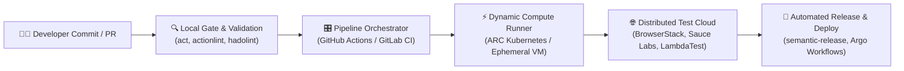

# 🚀 Awesome CI Build & Pipeline Integration

  

  
  
  
  
  

> 🌟 A curated directory of the best **Continuous Integration (CI) build tools, pipeline automation frameworks, test orchestration platforms, and self-hosted runner ecosystems**.

Accelerate your software delivery lifecycle with modern CI/CD pipeline integrations—spanning enterprise-scale hosted cloud platforms, automated cross-browser test grids, ephemeral runner scaling operators, and container-native build engines.

---

## 📑 Table of Contents

- [📊 Sector Overview & Market Dynamics](#-sector-overview--market-dynamics)
- [☁️ SaaS & Hosted CI/CD Platforms](#️-saas--hosted-cicd-platforms)
- [🛠️ Open-Source CI/CD Engines & Pipeline Tools](#️-open-source-cicd-engines--pipeline-tools)
- [🏗️ Architecture & Key Integration Patterns](#️-architecture--key-integration-patterns)
- [❓ Frequently Asked Questions (FAQ)](#-frequently-asked-questions-faq)
- [📈 Star History](#-star-history)
- [💖 Support](#-support)
- [🤝 How to Contribute](#-how-to-contribute)
- [📄 License & Disclaimer](#-license--disclaimer)

---

## 📊 Sector Overview & Market Dynamics

The global **Continuous Integration and Continuous Delivery (CI/CD) and Automated Pipeline Market** is estimated at **$2.5 Billion to $4.0 Billion**, projected to expand at a compound annual growth rate (CAGR) of **18%–22%**, surpassing **$8.5 Billion by 2030**. Growth is propelled by enterprise microservices adoption, developer productivity engineering (DPE), containerized workloads, and automated quality gates.

From a market structure perspective, the sector exhibits **bimodal dynamics**:
- 🏢 **Moderately Concentrated at the Platform Layer:** Foundational Git-centric platforms (GitHub Actions, GitLab CI, and Bitbucket Pipelines) demonstrate high consolidation and network effects, capturing the majority of developer mindshare in a near winner-take-most dynamic for source-to-pipeline workflow orchestration.
- 🧩 **Highly Fragmented across Execution & Specialized Services:** Parallel test clouds (BrowserStack, Sauce Labs, LambdaTest), ephemeral runner auto-scalers (Kubernetes ARC), local pipeline testing tools (`act`), and container caching engines (`dagger`, `earthly`) remain competitive and diverse, allowing engineering teams to assemble best-of-breed toolchains without platform lock-in.

---

## ☁️ SaaS & Hosted CI/CD Platforms

The table below lists leading SaaS and hosted CI/CD pipeline integration platforms, sorted in descending order by **Company Size (Market Capitalization or Enterprise Valuation)**.

| 🏢 Product / Platform | 💰 Company Size (Valuation / Revenue) | 🏷️ Starting Price | 🎁 Free Tier / Trial Limits | ⚡ Key Pipeline Capabilities |
|:----------------------|:--------------------------------------|:------------------|:----------------------------|:-----------------------------|
| **[GitHub Actions](https://github.com/features/actions)** | **~$3,100 Billion** ($3.1T Market Cap / $1B+ ARR) | **$4.00 per user/month** (GitHub Team plan; overage Linux compute at $0.008/min) | **2,000 build minutes/month** free forever on private repos (unlimited minutes on public repos) + 500 MB package storage | Fully integrated Git workflow triggers, matrix builds, marketplace ecosystem of 20,000+ actions, self-hosted and hosted runners (Linux, macOS, Windows). |
| **[Bitbucket Pipelines](https://bitbucket.org/product/features/pipelines)** | **~$45.0 Billion** ($45B Market Cap / ~$4B+ ARR) | **$3.00 per user/month** (Bitbucket Standard; includes 2,500 build minutes/month) | **50 build minutes/month** free forever for up to 5 users + 1 GB Git LFS storage | Built directly into Bitbucket repositories, native Jira issue linking, deployment environments with concurrency controls, and reusable Atlassian Pipes. |
| **[GitLab CI/CD](https://about.gitlab.com/stages-devops-lifecycle/continuous-integration/)** | **~$8.5 Billion** ($8.5B Market Cap / ~$700M+ ARR) | **$29.00 per user/month** (GitLab Premium; includes 10,000 compute minutes/month) | **400 compute minutes/month** free forever (up to 5 users per namespace) + 5 GB storage | Unified DevOps platform, Auto DevOps pipelines, integrated container registry, dynamic application security testing (DAST), and multi-project pipeline triggers. |
| **[BrowserStack CI Integrations](https://www.browserstack.com/)** | **$4.0 Billion** (Series B Valuation / ~$200M+ ARR) | **$129.00 per month** (billed annually for Automate Desktop, 1 parallel thread) | **14-day free trial** with **100 automated test minutes** & 1 parallel thread (lifetime free access for approved open-source projects) | Cloud test grid integration for Jenkins, GitHub Actions, GitLab, and Azure DevOps; automated browser/device testing, local tunneling, and flaky test quality gates. |
| **[CircleCI](https://circleci.com/)** | **$1.7 Billion** (Series F Valuation / ~$100M+ ARR) | **$15.00 per month** (Performance plan base, includes 30,000 credits/month & 5 active users) | **30,000 free credits/month** free forever (~3,000 Linux medium build minutes, max 5 active users, 30 concurrent jobs) | High-speed intelligent test splitting, Docker layer caching, customizable compute resource classes (Arm, GPU, macOS), and reusable Orbs. |
| **[Sauce Labs](https://saucelabs.com/)** | **~$1.0 Billion** (Private Equity Valuation / ~$150M+ ARR) | **$39.00 per month** (Live Testing billed annually) or **$149.00 per month** (Virtual Device Cloud, 1 parallel thread) | **28-day free trial** with **60 total automated & live testing minutes** and up to 3 parallel virtual machines | Comprehensive mobile app and cross-browser automated testing in CI pipelines, Sauce Connect secure tunneling, failure analysis, and error reporting. |
| **[Travis CI](https://www.travis-ci.com/)** | **~$500 Million** (Division Valuation under Idera Inc., ~$3.5B EV) | **$69.00 per month** (Core plan, 1 concurrent job, unlimited build minutes) | **30-day free trial** with **10,000 trial credits** (lifetime free access available for approved public open-source repos) | Established multi-language continuous integration service supporting Linux, macOS, and Windows build matrices with automated deployment connectors. |
| **[LambdaTest](https://www.lambdatest.com/)** | **~$250 Million** (Series C Valuation / TestMu AI) | **$15.00 per user/month** (Live Testing billed annually) or **$99.00 per month** (Web Automation, 1 parallel thread) | **60 live test minutes/month** free forever (6 sessions of 10 min) + **15-day free trial** with **100 automation minutes** | HyperExecute AI-driven test execution engine, parallel Selenium/Cypress/Playwright test suites, smart UI regression testing, and CI pipeline status webhooks. |

---

## 🛠️ Open-Source CI/CD Engines & Pipeline Tools

The following curated open-source projects power self-hosted CI build pipelines, local workflow verification, containerized orchestration, and automated release engineering.

Sorted in descending order by **GitHub Star Count**:

| 📦 Project | ⭐ Stars | 📝 Description | 🎯 Focus Area |
|:-----------|:---------|:---------------|:--------------|
| **[nektos/act](https://github.com/nektos/act)** |  | Run your GitHub Actions workflows locally using Docker to test and debug pipelines without pushing commits or triggering cloud quotas. | 🧪 Local Pipeline Runner |
| **[harness/drone](https://github.com/harness/drone)** |  | Container-native continuous integration and delivery platform that executes each pipeline step inside an isolated Docker container. | 🐳 Containerized CI Engine |
| **[jenkinsci/jenkins](https://github.com/jenkinsci/jenkins)** |  | Industry-standard open-source automation server with thousands of plugins supporting automated build, test, and deployment workflows. | 🔌 Extensible Automation Server |
| **[semantic-release/semantic-release](https://github.com/semantic-release/semantic-release)** |  | Fully automated version management and package publishing pipeline tool enforcing Semantic Versioning based on commit messages. | 🏷️ Automated Release & Versioning |
| **[argoproj/argo-workflows](https://github.com/argoproj/argo-workflows)** |  | Container-native workflow engine for orchestrating parallel CI/CD jobs and machine learning pipelines natively on Kubernetes clusters. | ☸️ Kubernetes Workflow Engine |
| **[dagger/dagger](https://github.com/dagger/dagger)** |  | Programmable CI/CD engine that lets developers construct pipelines as code in Python, Go, or TypeScript and run them anywhere (local or CI). | 💻 Programmable Pipeline Engine |
| **[hadolint/hadolint](https://github.com/hadolint/hadolint)** |  | Smarter Dockerfile linter that validates Dockerfiles against best practice rules to guarantee efficient and secure CI container builds. | 🔍 Container Linting & Quality Gate |
| **[earthly/earthly](https://github.com/earthly/earthly)** |  | Fast, reproducible, container-isolated build framework that combines Makefile simplicity with Docker isolation to eliminate CI flakes. | 🧱 Reproducible Build System |
| **[reviewdog/reviewdog](https://github.com/reviewdog/reviewdog)** |  | Automated code review utility that consumes linter outputs and posts diff annotations directly to pull requests across GitHub, GitLab, and Bitbucket. | 🐶 Automated PR Code Review |
| **[tektoncd/pipeline](https://github.com/tektoncd/pipeline)** |  | Cloud-native Kubernetes-standard CRD framework for declaring and executing modular, reusable continuous integration pipelines. | ⚙️ Kubernetes-Native Pipeline CRDs |
| **[woodpecker-ci/woodpecker](https://github.com/woodpecker-ci/woodpecker)** |  | Lightweight, community-governed CI engine fork of Drone that executes pipelines in containers with native multi-architecture support. | 🕊️ Lightweight Self-Hosted CI |
| **[concourse/concourse](https://github.com/concourse/concourse)** |  | Open-source CI/CD system built on declarative resources, tasks, and visual pipeline graphs designed for stateless infrastructure. | 🔄 Declarative Pipeline Automation |
| **[actions/actions-runner-controller](https://github.com/actions/actions-runner-controller)** |  | Kubernetes operator (ARC) that dynamically provisions and auto-scales self-hosted GitHub Actions runners based on real-time queue demand. | 📈 Autoscaling Runner Operator |
| **[actions/runner](https://github.com/actions/runner)** |  | Official cross-platform runner application executing workflow jobs for GitHub Actions on Linux, macOS, and Windows hosts. | 🏃 Core Workflow Runner |
| **[rhysd/actionlint](https://github.com/rhysd/actionlint)** |  | Fast static analysis linter for GitHub Actions workflow files (`.github/workflows/*.yml`) to catch syntax bugs and expression errors early. | 🛡️ Workflow Static Analysis |

---

## 🏗️ Architecture & Key Integration Patterns

A resilient and high-throughput CI/CD pipeline typically implements five foundational architectural layers:

1. 🔍 **Local Pre-Flight Validation:** Run workflow linters ([`actionlint`](https://github.com/rhysd/actionlint)) and containerized pipeline emulators ([`act`](https://github.com/nektos/act)) before pushing code to avoid wasting remote compute minutes.
2. 🧱 **Deterministic Build Caching:** Leverage containerized build frameworks ([`dagger`](https://github.com/dagger/dagger), [`earthly`](https://github.com/earthly/earthly)) with multi-layer caching to ensure identical build outcomes locally and in CI.
3. ⚡ **Dynamic Autoscaling Runners:** Deploy Kubernetes-native runner controllers ([`actions-runner-controller`](https://github.com/actions/actions-runner-controller)) to automatically scale ephemeral compute nodes up and down based on queue depth, reducing hosting costs.
4. 🌐 **Cloud Test Sharding:** Offload browser, mobile, and regression matrix test suites to parallelized execution clouds ([BrowserStack](https://www.browserstack.com/), [LambdaTest](https://www.lambdatest.com/), [Sauce Labs](https://saucelabs.com/)) with automated secure tunneling.
5. 🚀 **Zero-Touch Releases:** Automate semantic version calculation, changelog generation, and tag publication using [`semantic-release`](https://github.com/semantic-release/semantic-release) upon successful merge to the main branch.

---

## ❓ Frequently Asked Questions (FAQ)

### 💡 What is CI Build & Pipeline Integration?
CI Build & Pipeline Integration refers to connecting version control repositories (Git) with automated runners, compilers, linters, test grids, and deployment pipelines. Every code commit triggers an automated sequence that builds artifacts, validates tests, enforces security compliance, and reports status back to pull requests.

### ⚖️ Should I choose a hosted SaaS CI or self-hosted open-source runners?
- **Choose Hosted SaaS (GitHub Actions, GitLab CI, CircleCI)** for minimal operational overhead, zero infrastructure maintenance, instant global runner pools, and turnkey marketplace integrations.
- **Choose Self-Hosted Open-Source (Actions Runner Controller, Jenkins, Woodpecker, Drone)** if you require strict data sovereignty, specialized on-premise hardware (e.g., custom GPUs, internal network access), or want to optimize compute costs for high-volume builds.

### 🛡️ How do I eliminate flaky tests in CI pipelines?
Utilize test sharding, dynamic retry mechanisms, isolated container environments with [`earthly`](https://github.com/earthly/earthly), and automated quality gate integrations (e.g., BrowserStack or Sauce Labs) that quarantine failing tests and separate genuine code regressions from environmental flakes.

---

## 📈 Star History

---

## 💖 Support

If you find this curated directory helpful for your CI/CD pipelines, DevOps workflows, or platform engineering architecture:

- ⭐ **Star this repository** on GitHub to show your appreciation and help others discover it!
- 🍴 **Fork the repo** to add your company's internal pipelines or suggest enhancements.
- 📢 **Share with colleagues** and DevOps communities on LinkedIn, Twitter/X, and Discord.
- ☕ **Buy a coffee & sponsor**: Support ongoing research, updates, and curation via the [GitHub Sponsor Dashboard](https://github.com/sponsors/ishandutta2007).

---

## 🤝 How to Contribute

We welcome additions, corrections, and updates from the DevOps and software engineering community!

1. 🍴 **Fork** this repository.
2. 📝 **Add or update entries** in `README.md` following the table schema:
   - For SaaS products: include official product link, parent company size (valuation/revenue), exact starting price, and specific free tier/trial limits.
   - For Open-Source projects: include the official repository URL, star count badge (`style=social&color=white` linking to `/stargazers`), and concise description.
3. 🔢 Keep the tables **properly sorted**:
   - SaaS table sorted by **Company Size (descending)**.
   - Open-Source table sorted by **GitHub Stars (descending)**.
4. 🚀 Submit a **Pull Request** with a brief summary of the changes.

---

## 📄 License & Disclaimer

- 📜 Distributed under the [MIT License](file:///C:/Users/ishan/Documents/Projects/Awesome-CI-Build-Pipeline-Integration/LICENSE).
- ⚠️ This list is community-curated for informational purposes. Product names, logos, and brands are property of their respective owners. Always review security practices, access permissions, and secret management policies when configuring CI/CD pipelines.
